<p align="center">
  
</p>

<h3 align="center">I build things that keep working when the internet doesn't.</h3>

<p align="center">
  <a href="https://www.linkedin.com/in/sanjay-grover-5379a4196/"></a>
  <a href="mailto:sanjaygrover@gmail.com"></a>
  <a href="https://leetcode.com/u/sanjaygrover/"></a>
  <a href="https://codeforces.com/profile/sanjaygrover"></a>
  <a href="https://www.codechef.com/users/sanjaygrover"></a>
</p>

```text
$ whoami
sanjay-grover · computer engineering @ NIT Kurukshetra · Kurukshetra, IN

$ cat now.txt
→ teaching a local LLM to wake up when I say "JARVIS"
→ turning a GATE previous-year-questions book into an offline practice tracker
→ grinding contests on LeetCode / Codeforces / CodeChef

$ uptime --network
connection unstable. shipping anyway.
```

---

## 🛰️ In the lab

### 🎙️ JARVIS: a local-first voice assistant
*Status: 🚧 in progress*

A personal assistant that lives on my own machine. Say the wake word and it starts listening, an **on-device LLM** works out what I want, and my own **MCP server** hands it a growing toolbox of micro-services to actually do things. No cloud required.

```text
 "JARVIS…"  ──►  voice input  ──►  on-device LLM  ──►  MCP server  ──►  micro-services
 wake word       speech → text      reasoning           tool router       tool · tool · tool · …
```

The goal: as many genuinely useful tools as I can fit behind one voice.

### 📚 GATE PYQ Tracker: practice without scribbling in the book
*Status: 🚧 in progress*

I want to solve the same previous-year-questions book again and again, and you can't tick answers in print more than once. So I'm building an **offline-first** app (the network here is down more often than up) with:

- a **dashboard** home screen
- **question slides** for every chapter and sub-chapter
- an **answers review** slide after each attempt
- a **score per sub-chapter**, with full stored history
- **auto-numbered revisions**: Revision 1, 2, 3… of the same chapter

---

## 📦 Shipped & sandboxes

| Project | What it is | Stack |
|---|---|---|
| [**Excalibur**](https://github.com/SanjayGrover/Excalibur) · [**2024 edition**](https://github.com/SanjayGrover/Excalibur-2024) | Built for Excalibur at Techspardha 2024, NIT Kurukshetra's tech fest | Python |

---

## 🧭 Rules I build by

1. **Offline first.** If it needs the internet to start, it isn't finished.
2. **Small tools, composed.** One job per micro-service; the magic is in how they connect.
3. **Local beats cloud** when the data is mine.

---

## 🧰 Loadout

<details>
<summary><b>Open the toolbox</b></summary>

<br>

**Languages & frameworks**


**Hardware & IoT**


**AI & tooling**


</details>

---

<p align="center">
  Open to hackathons, open source, and AI + embedded collaborations. <br>
  <a href="mailto:sanjaygrover@gmail.com">Say hi</a> · best viewed offline 😉
</p>
